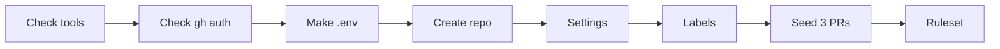

# 00 · Before the talk

**The big idea:** get set up once, then everything else is one command.

## Why it matters
Setup is where demos die. One script checks every tool, makes the repo, and turns on every setting, so the talk itself is just running commands.

## Run it
    pwsh ./00_Prerequisites/run.ps1

## What you'll see
1. A table of your tools (pwsh, docker, sqlcmd, gh, git) with versions, or how to install what's missing.
2. A check that `gh` has the `project` scope. If not, it tells you to run `gh auth refresh -s project`.
3. A `.env` file with a random SQL password. It's gitignored.
4. The repo created on GitHub, if it doesn't exist yet.
5. Auto-merge, delete branch on merge, and the wiki turned on.
6. Seven labels created.
7. Three small labeled pull requests merged, so release notes have real history.
8. A ruleset on `main`: pull request required, `database-tests` must pass, Copilot reviews.
9. A "you're ready" summary, plus any clicks left to do.

## How it works

- [run.ps1](run.ps1) does every step and is safe to run twice.
- [ruleset.json](ruleset.json) is the branch ruleset for `main`. Approvals are set to 0 so a solo presenter can merge. Real teams should use 1 or more.
- [seed/](seed/) holds the three small changes for the seeded pull requests.

**Install the tools**

| Tool | Mac | Windows |
|---|---|---|
| PowerShell 7 | `brew install powershell` | `winget install Microsoft.PowerShell` |
| Docker Desktop | [Download](https://docs.docker.com/desktop/setup/install/mac-install/) | `winget install Docker.DockerDesktop` |
| GitHub CLI | `brew install gh` | `winget install GitHub.cli` |
| go-sqlcmd (optional) | `brew install sqlcmd` | `winget install sqlcmd` |
| Git | `xcode-select --install` | `winget install Git.Git` |

sqlcmd is optional on your laptop. Without it, the scripts use the sqlcmd inside the SQL Server container.

**Heads up for private repos.** On a free GitHub plan, private repos can't use rulesets or the wiki. The script tells you if a step didn't apply. Make the repo public, or use GitHub Pro or Team.

## Play with it
- Run it twice. The second run changes nothing.
- Change the approvals in `ruleset.json` to 1, run it again, and watch the demo PRs wait for a review.
- Delete `.env` and run it again to get a new password.

## Learn more
- [About rulesets](https://docs.github.com/en/repositories/configuring-branches-and-merges-in-your-repository/managing-rulesets/about-rulesets)
- [GitHub CLI manual](https://cli.github.com/manual/)
- [Download and install sqlcmd](https://learn.microsoft.com/en-us/sql/tools/sqlcmd/sqlcmd-download-install)
