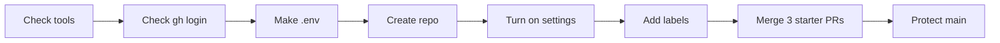

# 00 · Set up your repo

Run this once before anything else. It checks your tools and gets your fork of the repo ready, so every other step just works.

## Install the tools
Do this part first. Copy and run each line for your computer. You can skip any tool you already have.

### Mac
PowerShell 7
```bash
brew install powershell
```
Docker Desktop (you can also [download it here](https://docs.docker.com/desktop/setup/install/mac-install/))
```bash
brew install --cask docker
```
GitHub CLI
```bash
brew install gh
```
Git
```bash
xcode-select --install
```
go-sqlcmd. This one's optional. If you skip it, the scripts use the copy inside the SQL Server container.
```bash
brew install sqlcmd
```

### Windows
PowerShell 7
```powershell
winget install Microsoft.PowerShell
```
Docker Desktop
```powershell
winget install Docker.DockerDesktop
```
GitHub CLI
```powershell
winget install GitHub.cli
```
Git
```powershell
winget install Git.Git
```
go-sqlcmd. This one's optional. If you skip it, the scripts use the copy inside the SQL Server container.
```powershell
winget install sqlcmd
```

### Sign in to GitHub
Then sign in with the GitHub CLI and give it the `project` permission the board in step 04 needs.
```powershell
gh auth login
```
```powershell
gh auth refresh -s project
```

## Run it
```powershell
pwsh ./00_Prerequisites/run.ps1
```

## What happens
1. You get a table of your tools (pwsh, docker, sqlcmd, gh, git) and their versions. If something's missing, it tells you how to install it.
2. It checks that `gh` has the `project` permission. If it doesn't, it tells you to run `gh auth refresh -s project`.
3. It makes a `.env` file with a random SQL password. Git ignores this file, so the password never gets committed.
4. It creates the repo on GitHub if it doesn't exist yet.
5. It turns on auto-merge, deleting branches after they merge, and the wiki.
6. It creates seven labels.
7. It opens and merges three small labeled pull requests. That gives the release notes in step 04 some real history to work with.
8. It adds a ruleset to `main`. Every change needs a pull request, the `database-tests` check has to pass, and Copilot reviews the code.
9. It prints a "you're ready" summary along with any clicks you still need to do.

## The files
- [run.ps1](run.ps1) does every step above. It's safe to run more than once.
- [ruleset.json](ruleset.json) holds the rules for `main`. Required approvals are set to 0 so one person can run the whole talk alone. A real team should set it to 1 or more.
- [seed/](seed/) holds the three small changes used for the seeded pull requests.

Here's the order things happen in.



## A note on private repos
On the free GitHub plan, private repos can't use rulesets or the wiki. The script will tell you if a step got skipped. To get everything, make the repo public or use GitHub Pro or Team.

## Try it yourself
- Run it twice. The second run doesn't change anything.
- Change the approvals in `ruleset.json` to 1, run it again, and watch the demo pull requests sit and wait for a review.
- Delete `.env` and run it again to get a new password.

## Want to dig deeper?
- [About rulesets](https://docs.github.com/en/repositories/configuring-branches-and-merges-in-your-repository/managing-rulesets/about-rulesets) explains how branch protection works.
- [GitHub CLI manual](https://cli.github.com/manual/) lists every `gh` command.
- [Download and install sqlcmd](https://learn.microsoft.com/en-us/sql/tools/sqlcmd/sqlcmd-download-install) if you want sqlcmd on your laptop.
