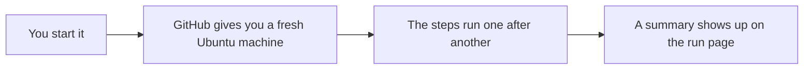

# 01 · Your first GitHub workflow

A workflow is just a file in your repo. Something kicks it off, GitHub hands you a fresh machine, your steps run in order, and you get a result at the end.

If you've ever set up a SQL Agent job, you already know most of this. There's a schedule or a trigger, a job, and a list of steps. The difference is that here it's all written down in a YAML file that lives right next to your code, so it gets reviewed and versioned like everything else.

## Run it
```powershell
pwsh ./01_FirstWorkflow/run.ps1
```

## What happens
1. The workflow file shows up with line numbers so we can walk through the trigger, the job, and the steps.
2. The workflow kicks off on GitHub.
3. You watch the run live in the terminal.
4. The run opens in the browser, and there's a little summary table waiting at the bottom.

## The files
There are only two files in this demo.

- [01-hello-workflow.yml](../.github/workflows/01-hello-workflow.yml) is the workflow. This is the part GitHub actually runs. Open it and you'll see the trigger at the top (`on:`), then one job, then the steps listed in order.
- [run.ps1](run.ps1) is just the script I use on stage. It prints the workflow file, tells GitHub to start it, and then shows the run in the terminal and the browser. You don't need it to use GitHub Actions. You could click the **Run workflow** button on the Actions tab and get the same result.

Here's the whole thing as a picture.



## Try it yourself
Make a small change to the workflow file, push it, and run the demo again to see what's different.

- Copy one of the steps, rename it, and have it print `Hello, Portland`.
- Add `push:` on the line under `on:`. Now the workflow runs on its own every time you push code, no button needed.
- Change `ubuntu-latest` to `windows-latest`. The summary table will show a different Runner OS.

## Want to dig deeper?
- [Understanding GitHub Actions](https://docs.github.com/en/actions/get-started/understand-github-actions) is a good first read if this is all new.
- [Workflow syntax](https://docs.github.com/en/actions/reference/workflows-and-actions/workflow-syntax) lists everything you can put in a workflow file.
- [Adding a job summary](https://docs.github.com/en/actions/reference/workflows-and-actions/workflow-commands#adding-a-job-summary) shows how the summary table at the end was made.
