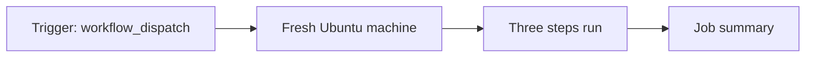

# 01 · How a workflow works

**The big idea:** a workflow is just a file. Something happens, a fresh machine starts, steps run, and you get a result.

## Why it matters
If you can read a SQL Agent job, you can read a workflow. It's a trigger, a job, and steps, written down in a file that lives with your code.

## Run it
    pwsh ./01_FirstWorkflow/run.ps1

## What you'll see
1. The workflow file with line numbers, so you can point at the trigger, the job, and the steps.
2. The workflow starts on GitHub.
3. The run streams live in the terminal.
4. The run opens in the browser with a job summary table.

## How it works

- [01-hello-workflow.yml](../.github/workflows/01-hello-workflow.yml) is the workflow.
- [run.ps1](run.ps1) shows it, starts it with `gh workflow run`, and follows it with `gh run watch`.

## Play with it
- Add a fourth step that prints `Hello, Portland`.
- Add `push:` under `on:` so it runs on every push.
- Change `ubuntu-latest` to `windows-latest` and compare the summary.

## Learn more
- [Understanding GitHub Actions](https://docs.github.com/en/actions/get-started/understand-github-actions)
- [Workflow syntax](https://docs.github.com/en/actions/reference/workflows-and-actions/workflow-syntax)
- [Adding a job summary](https://docs.github.com/en/actions/reference/workflows-and-actions/workflow-commands#adding-a-job-summary)
