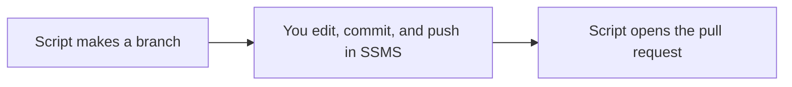

# 02 · Use GitHub from SSMS

You don't have to leave SSMS to use GitHub. SSMS 22 can talk to Git directly, so the scripts you already write get a history, a reviewer, and an easy way back if something goes wrong.

Think about the last time someone asked "which version of this proc is in prod?" With this setup you can answer that. Every change shows who made it, why they made it, and you can undo it with one click.

## Run it
```powershell
pwsh ./02_SSMS/run.ps1 -Pause
```

## What happens
1. The script makes a fresh branch called `demo/ssms-change` and pushes it to GitHub.
2. It prints the clicks to do in SSMS 22. You open the repo, switch to that branch, open the proc, ask Copilot to explain it, make a small edit, then commit and push.
3. The script waits while you do all of that in SSMS.
4. Once you're back, it opens a pull request from your commit and shows it in the browser.

## The files
- [run.ps1](run.ps1) makes the branch at the start and opens the pull request at the end. Everything in the middle happens in SSMS.
- [usp_GetActiveOrders.sql](../database/procs/usp_GetActiveOrders.sql) is the proc you edit.

Here's the flow.



## Set up SSMS 22 once
Git and GitHub Copilot don't come turned on in SSMS 22. You add them like this.

1. Open the **Visual Studio Installer**.
2. Next to SQL Server Management Studio 22, click **Modify**.
3. Check **Git integration** and **GitHub Copilot**, then click **Modify**.
4. Back in SSMS, sign in to GitHub from the account menu in the top right.

## Try it yourself
- Ask Copilot in SSMS to add a `@CustomerId` parameter to the proc.
- Make two commits instead of one, then look at the history in the pull request.
- Close the pull request without merging it. Nothing on `main` changes, which is the whole point of working on a branch.

## Want to dig deeper?
- [SSMS 22 install](https://learn.microsoft.com/en-us/ssms/install/install) walks through installing SSMS 22.
- [SSMS FAQ](https://learn.microsoft.com/en-us/ssms/faq) explains the optional Git and Copilot components.
- [GitHub Copilot in SSMS](https://learn.microsoft.com/en-us/ssms/github-copilot/overview) covers what Copilot can do inside SSMS.
