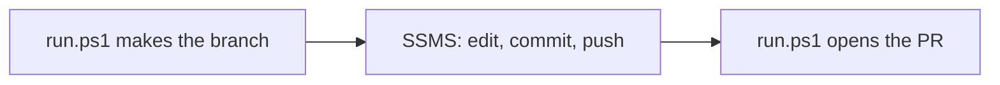

# 02 · SSMS meets GitHub

**The big idea:** you don't have to leave SSMS to work with GitHub. Your scripts become code with history, a reviewer, and a way back.

## Why it matters
"Which version of this proc is in prod?" stops being a question. Every change has an author, a reason, and a one-click undo.

## Run it
    pwsh ./02_SSMS/run.ps1 -Pause

## What you'll see
1. A fresh branch, `demo/ssms-change`, pushed to GitHub.
2. The clicks to do in SSMS 22: open the repo, switch branch, open the proc, ask Copilot to explain it, make a small edit, commit and push.
3. The script waits while you do that.
4. A pull request opens from your commit and shows in the browser.

## How it works

- [run.ps1](run.ps1) makes the branch and opens the pull request.
- [usp_GetActiveOrders.sql](../database/procs/usp_GetActiveOrders.sql) is the proc you edit.

**Set up SSMS 22 once.** Git and GitHub Copilot are optional components in SSMS 22.
1. Open the **Visual Studio Installer**.
2. Next to SQL Server Management Studio 22, click **Modify**.
3. Check **Git integration** and **GitHub Copilot**, then click **Modify**.
4. In SSMS, sign in to GitHub from the account menu in the top right.

## Play with it
- Ask Copilot in SSMS to add a `@CustomerId` parameter to the proc.
- Make two commits and look at the history in the pull request.
- Close the pull request without merging. Nothing on `main` changed.

## Learn more
- [SSMS 22 install](https://learn.microsoft.com/en-us/ssms/install/install)
- [SSMS FAQ: Git and Copilot components](https://learn.microsoft.com/en-us/ssms/faq)
- [GitHub Copilot in SSMS](https://learn.microsoft.com/en-us/ssms/github-copilot/overview)
