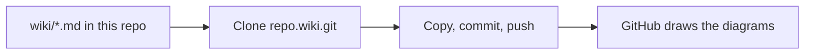

# 03 · Docs that live with the code

**The big idea:** when docs and diagrams are text, they get reviewed and versioned like everything else. No more stale Visio file on a share.

## Why it matters
The runbook you need at 2 AM should match what's actually deployed. When docs sit next to the code, they change in the same pull request.

## Run it
    pwsh ./03_DocsWikiMermaid/run.ps1

## What you'll see
1. The wiki gets cloned. It's just another Git repo.
2. If the wiki is brand new, the script opens it and asks you to save one page first. GitHub requires that once.
3. The wiki is made to match the `wiki/` folder exactly, then pushed. Pages that aren't in the folder are removed. The wiki's history keeps them.
4. The wiki opens, with a diagram on every page.

## How it works

- [wiki/](wiki/) holds every page as Markdown.
- [run.ps1](run.ps1) publishes them.

| Page | Diagram |
|---|---|
| [Home](wiki/Home.md) | flowchart |
| [How We Decide What To Automate](wiki/How-We-Decide-What-To-Automate.md) | flowchart |
| [DemoShop Data Model](wiki/DemoShop-Data-Model.md) | erDiagram |
| [Pull Request Flow](wiki/Pull-Request-Flow.md) | sequenceDiagram |
| [Branching](wiki/Branching.md) | gitGraph |
| [Deployment Runbook](wiki/Deployment-Runbook.md) | flowchart |

## Play with it
- Edit a page in the GitHub wiki editor, then run the script. The folder wins, because the folder is what gets reviewed.
- Add a column to the ER diagram and run the script again.
- Paste a diagram into any issue or PR comment. GitHub draws it there too.
- Try the [Mermaid live editor](https://mermaid.live) to sketch a new diagram.

## Learn more
- [Creating diagrams on GitHub](https://docs.github.com/en/get-started/writing-on-github/working-with-advanced-formatting/creating-diagrams)
- [About wikis](https://docs.github.com/en/communities/documenting-your-project-with-wikis/about-wikis)
