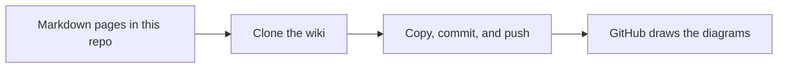

# 03 · Docs and diagrams in a wiki

When your docs and diagrams are plain text in the repo, they get reviewed and versioned just like your SQL. No more out of date Visio file sitting on a file share that nobody remembers to update.

This matters most when things go wrong. The runbook you pull up at 2 AM should match what's actually deployed. If the docs live next to the code, they change in the same pull request as the code.

## Run it
```powershell
pwsh ./03_DocsWikiMermaid/run.ps1
```

## What happens
1. The script clones the wiki. A GitHub wiki is really just another Git repo.
2. If the wiki is brand new, the script opens it and asks you to save one page first. GitHub makes you do that once before anything can be pushed.
3. The script copies the `wiki/` folder into the wiki, commits, and pushes. Any page that isn't in the folder gets removed, but the wiki's history still has it.
4. The wiki opens in your browser. Click around the sidebar. Every page has a diagram.

## The files
- [wiki/](wiki/) holds every page as a Markdown file. This is the copy that gets reviewed.
- [run.ps1](run.ps1) publishes those pages to the GitHub wiki.

The wiki is written like a real DBA team's wiki for DemoShop. Some of it is tied to this repo, like the labels, the board, and the naming rules. Some of it is made up, like the on-call schedule, so you have a realistic example to copy. Every page has a Mermaid diagram.

| Page | What a DBA uses it for | Diagram type |
|---|---|---|
| [Home](wiki/Home.md) | Quick links, the team, and how work reaches us | flowchart |
| [Request A Database Change](wiki/Request-A-Database-Change.md) | How to file a good request and what happens next | stateDiagram |
| [Project Board](wiki/Project-Board.md) | The board columns, the Server and Risk fields, and triage | flowchart |
| [Reviewing Pull Requests](wiki/Reviewing-Pull-Requests.md) | What needs a DBA, what to check, and how to approve | sequenceDiagram |
| [Labels](wiki/Labels.md) | Every label, what it means, and who adds it | flowchart |
| [On-Call Rotation](wiki/On-Call-Rotation.md) | Who's on call, escalation, and the handoff checklist | gantt |
| [Incident Response SOP](wiki/Incident-Response-SOP.md) | Severity levels, the first 15 minutes, and handy queries | flowchart |
| [Naming Conventions](wiki/Naming-Conventions.md) | How to name tables, keys, indexes, procs, files, and branches | mindmap |
| [Branching](wiki/Branching.md) | How a change moves from a branch to `main` | gitGraph |
| [Deployment Runbook](wiki/Deployment-Runbook.md) | The pre-deploy checklist and what to do if it goes wrong | flowchart |
| [How We Decide What To Automate](wiki/How-We-Decide-What-To-Automate.md) | The 3 F's and 4 R's | flowchart |
| [DemoShop Data Model](wiki/DemoShop-Data-Model.md) | Tables, keys, and procs | erDiagram |
| [Maintenance And Backups](wiki/Maintenance-And-Backups.md) | The maintenance window, nightly jobs, and restore tests | gantt |

[_Sidebar.md](wiki/_Sidebar.md) and [_Footer.md](wiki/_Footer.md) add the menu on the side and the note at the bottom of every page. The wiki links to the [Database Work project board](https://github.com/users/amyabelsql/projects/11). If you fork this repo, change that link to your own board.

Here's how the publishing works.



## Try it yourself
- Edit a page right in the GitHub wiki editor, then run the script. Your edit gets replaced, because the folder in the repo is the version that was reviewed.
- Add yourself to the on-call schedule and run the script again.
- Add a column to the data model diagram and run the script again.
- Paste a Mermaid diagram into any issue or pull request comment. GitHub draws it there too.
- Sketch a new diagram in the [Mermaid live editor](https://mermaid.live) before you add it to a page.

## Want to dig deeper?
- [Creating diagrams on GitHub](https://docs.github.com/en/get-started/writing-on-github/working-with-advanced-formatting/creating-diagrams) shows every diagram type GitHub can draw.
- [About wikis](https://docs.github.com/en/communities/documenting-your-project-with-wikis/about-wikis) explains how GitHub wikis work.
