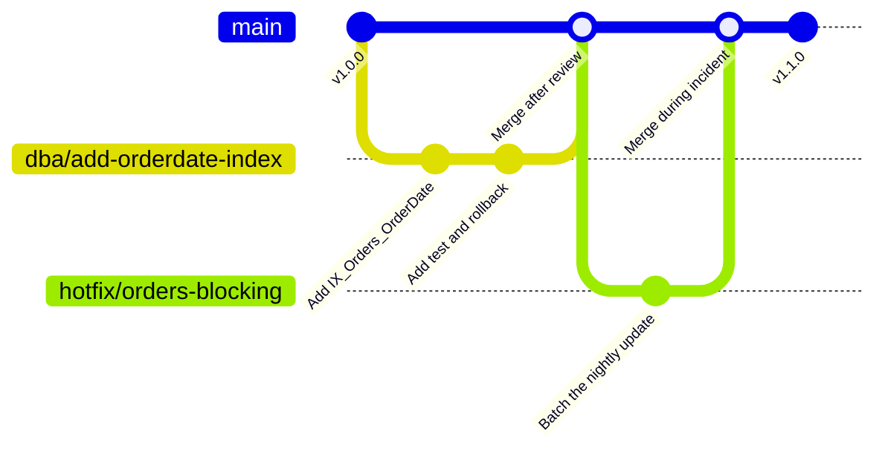

# Branching

`main` is always deployable. Every change goes on a short branch and comes back through a pull request. Branches should live for days, not weeks. The longer a branch lives, the harder it is to merge.

## How a change moves

1. Create a branch from `main`. Name it using the [[Naming conventions|Naming-Conventions]], like `dba/add-orderdate-index`.
2. Commit your change, the test, and the rollback script.
3. Push and open a pull request.
4. If the tests fail, fix it on the same branch. Don't open a new pull request.
5. Once it's approved and green, it merges. The branch gets deleted automatically.

## Hotfixes

During an incident, branch from `main` and name it `hotfix/...`. It still needs a pull request and the tests still have to pass. The only difference is that it can skip the maintenance window and gets reviewed right away.
