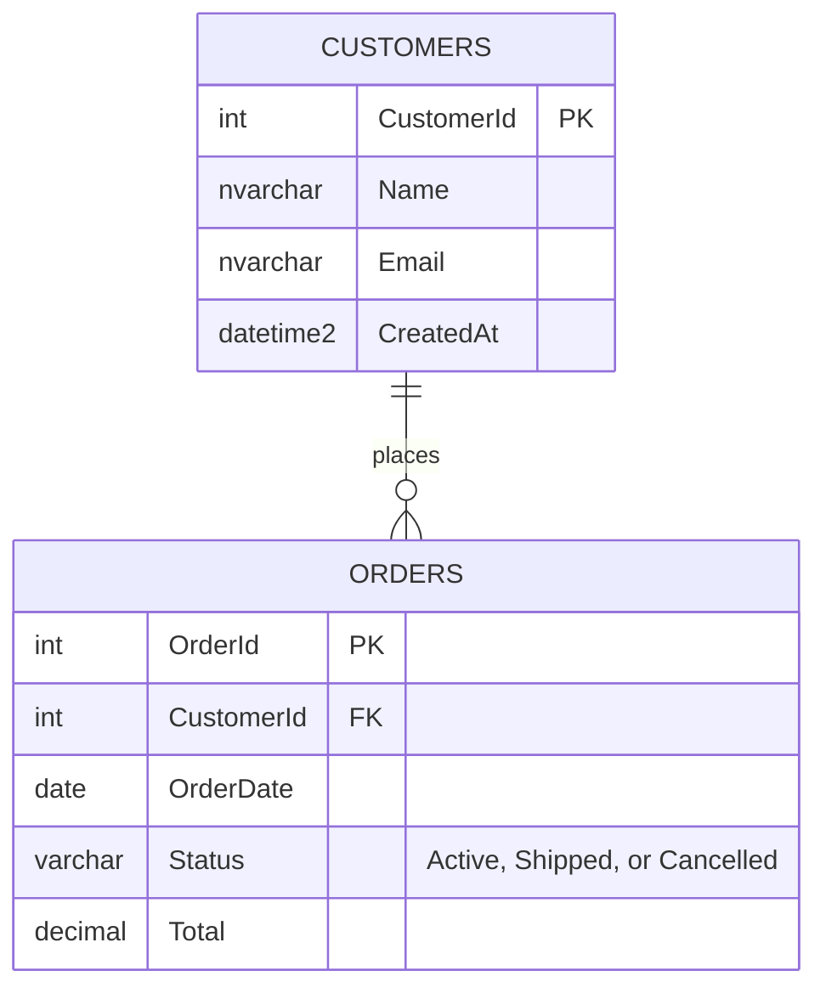

# DemoShop data model

Two tables. Every order belongs to one customer. Scripts live in `database/schema/`.

`dbo.usp_GetActiveOrders` returns the orders where `Status = 'Active'`, with the customer name.
