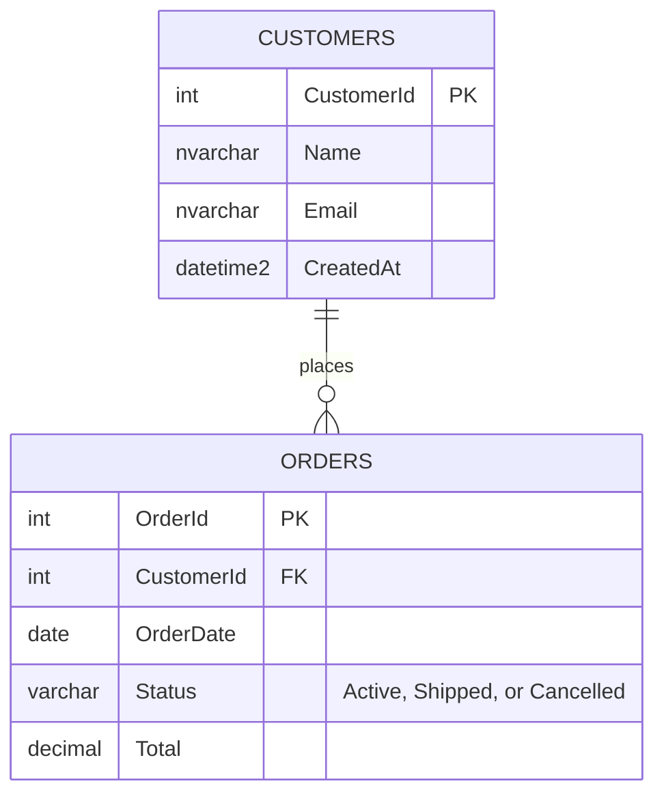

# DemoShop data model

DemoShop has two tables. Every order belongs to one customer. The scripts that build them live in `database/schema/`, and the constraint names follow the [[Naming conventions|Naming-Conventions]].

## Keys and constraints

| Name | What it does |
|---|---|
| `PK_Customers`, `PK_Orders` | Primary keys |
| `FK_Orders_Customers` | Every order must point to a real customer |
| `CK_Orders_Status` | Status can only be Active, Shipped, or Cancelled |
| `CK_Orders_Total` | Total can't be negative |
| `DF_Customers_CreatedAt` | Fills in CreatedAt when a customer is added |
| `IX_Orders_OrderDate` | Speeds up reports that look up orders by date |

## Procs

| Proc | What it returns |
|---|---|
| `dbo.usp_GetActiveOrders` | Orders where `Status = 'Active'`, with the customer name |
