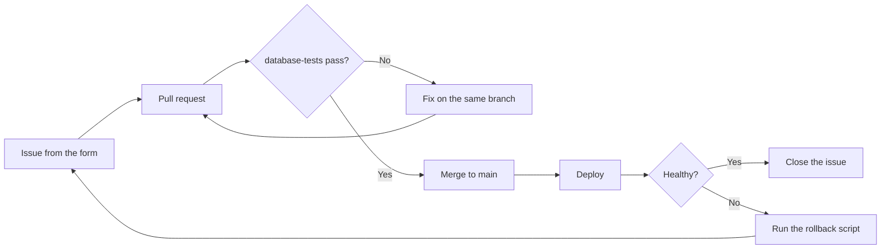

# Deployment runbook

From request to production, with a way back at every step.

1. Every request starts as a **Database change request** issue.
2. The pull request includes the change, a test, and a rollback script in `database/rollback/`.
3. If anything looks wrong after deploy, run the rollback script and reopen the issue.
