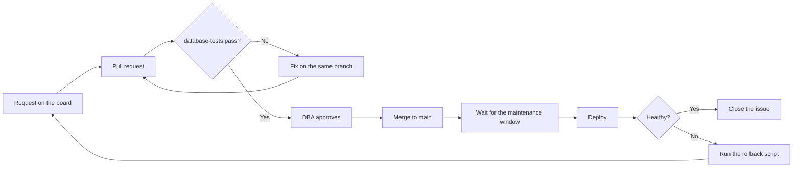

# Deployment runbook

How a change gets from a request to production, with a way back at every step.

## Before you deploy

- [ ] The pull request is merged and `database-tests` passed
- [ ] The issue has Server and Risk filled in on the [project board](https://github.com/users/amyabelsql/projects/11)
- [ ] High risk? It's inside the maintenance window and someone else is online with you
- [ ] You know where the rollback script is, and you've read it
- [ ] For a data fix, you've taken a backup of the affected rows or confirmed the last log backup is recent

## Deploy

1. Post in the team channel that you're starting, with a link to the issue.
2. Run the scripts in the order they're listed in the pull request.
3. Check that the change did what it should. Run the test from `database/tests/` against the server if you can.
4. Watch for blocking and errors for 15 minutes.
5. Post that you're done and close the issue.

## If it goes wrong

Don't debug in production. Run the rollback script from `database/rollback/`, confirm things are back to normal, then reopen the issue and figure it out on a branch. If users are affected, switch to the [[Incident response SOP|Incident-Response-SOP]].
