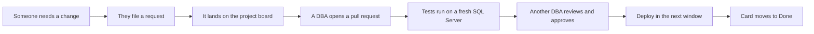

# DemoShop Data Team

Welcome. This is where the DemoShop data team keeps how we work. If you need something from a DBA, are about to go on call, or just want to know why we name things the way we do, start here.

## I need to...

| I need to... | Go here |
|---|---|
| Ask for a database change | [[Request a database change|Request-A-Database-Change]] |
| See what the team is working on | [Database Work project board](https://github.com/users/amyabelsql/projects/11) |
| Get a pull request reviewed | [[Reviewing pull requests|Reviewing-Pull-Requests]] |
| Handle something that's broken right now | [[Incident response SOP|Incident-Response-SOP]] |
| Find out who's on call | [[On-call rotation|On-Call-Rotation]] |
| Name a new table, proc, or index | [[Naming conventions|Naming-Conventions]] |
| Ship a change to production | [[Deployment runbook|Deployment-Runbook]] |

## How work gets to us

## The team

| Who | Focus |
|---|---|
| Amy | Team lead, CODEOWNER for `database/` and `.github/` |
| Priya | Performance and indexing |
| Marcus | Backups, restores, and HA |
| Jordan | Automation and pipelines |

Team standup is Monday at 9:30 AM. That's also when we triage new requests on the board and hand off on call.

## About this wiki

Every page here is a Markdown file in the repo under `03_DocsWikiMermaid/wiki/`. Changes go through a pull request just like code, so the docs and the database stay in sync. If you edit a page here in the browser, it gets replaced the next time the wiki is published, so make your change in the repo instead.
