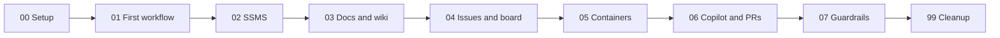

# DemoShop team wiki

This wiki lives as Markdown in the repo, in `03_DocsWikiMermaid/wiki/`. Every page gets reviewed in a pull request, just like code.

## The eight steps

## Pages
- [[How We Decide What To Automate|How-We-Decide-What-To-Automate]]
- [[DemoShop Data Model|DemoShop-Data-Model]]
- [[Pull Request Flow|Pull-Request-Flow]]
- [[Branching]]
- [[Deployment Runbook|Deployment-Runbook]]
