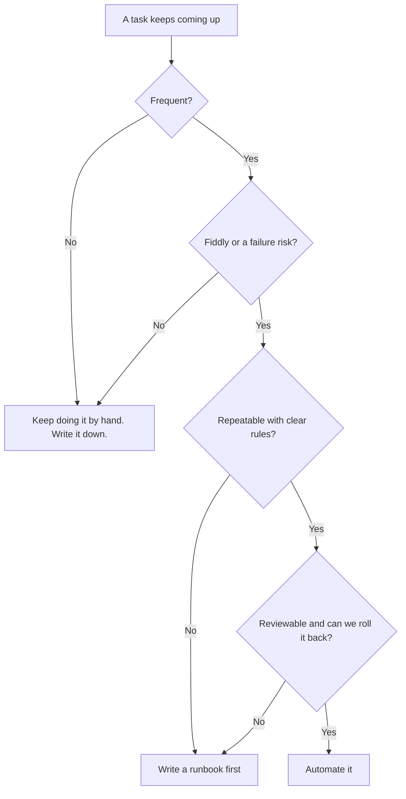

# How we decide what to automate

**The 3 F's** tell us if a task is worth it: it happens **F**requently, it's **F**iddly, and it's a **F**ailure risk when a person does it by hand.

**The 4 R's** tell us if it's ready: it's **R**epeatable, it has **R**ules we can write down, the result is **R**eviewable, and we can **R**oll it back.

