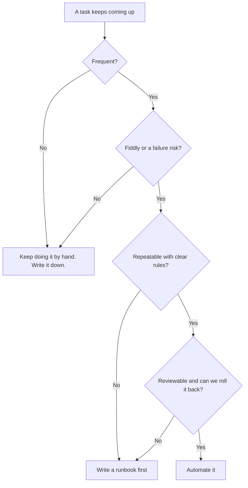

# How we decide what to automate

Before we automate something, we ask two sets of questions. The first set, the 3 F's, tells us if a task is worth automating. Does it happen **F**requently, is it **F**iddly, and is it a **F**ailure risk when a person does it by hand?

The second set, the 4 R's, tells us if it's ready. Is it **R**epeatable, does it have **R**ules we can write down, is the result **R**eviewable, and can we **R**oll it back?

If the answer is no on the readiness side, write a runbook first. A good runbook is usually the first draft of the automation.

