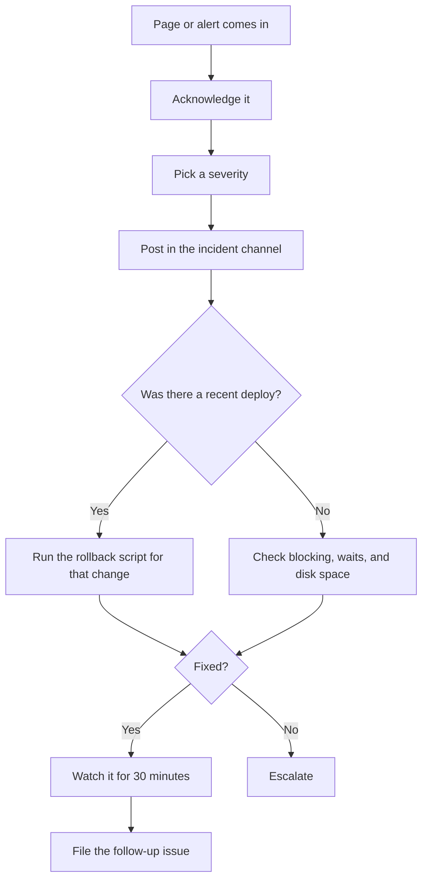

# Incident response SOP

Use this when something in production is broken or about to be. Follow the steps in order. When you're stressed, it's easy to skip one.

## How bad is it?

| Severity | What it looks like | Response |
|---|---|---|
| SEV 1 | DemoShop is down, or data is lost or wrong | Page the team lead now. Update every 30 minutes. |
| SEV 2 | It works, but it's slow or one feature is broken | On call handles it. Update every hour. |
| SEV 3 | Something is off, but no users notice yet | Fix it during business hours. File an issue. |

When in doubt, call it one level higher. It's easy to lower the severity later.

## The first 15 minutes



1. **Acknowledge** the page so nobody else starts on it.
2. **Pick a severity** using the table above.
3. **Post an update** in the incident channel using the template below.
4. **Check recent changes.** Look at what merged to `main` in the last day. If a change lines up with when things broke, roll it back first and investigate later. Every change has a rollback script in `database/rollback/`.
5. **Look around.** If nothing was deployed, check the basics with the queries below.
6. **Escalate** if you're not making progress. See [[On-call rotation|On-Call-Rotation]] for who to call.

## Handy first queries

Who's running what right now, and who's blocking whom.

```sql
SELECT r.session_id, r.blocking_session_id, r.status, r.wait_type,
       r.wait_time, r.cpu_time, DB_NAME(r.database_id) AS database_name,
       t.text AS running_sql
FROM sys.dm_exec_requests AS r
CROSS APPLY sys.dm_exec_sql_text(r.sql_handle) AS t
WHERE r.session_id <> @@SPID
ORDER BY r.wait_time DESC;
```

How full each data and log file is.

```sql
SELECT DB_NAME() AS database_name, name AS file_name, type_desc,
       size / 128 AS size_mb,
       FILEPROPERTY(name, 'SpaceUsed') / 128 AS used_mb
FROM sys.database_files;
```

## Update template

Copy this into the incident channel. Keep it short and send it on schedule, even if nothing changed.

```text
[SEV 2] DemoShop orders page is slow
Started: 2:10 PM
Impact: Order lookups take 20+ seconds. Checkout still works.
What we know: Blocking on dbo.Orders since the 2:00 PM deploy.
Next step: Rolling back the 2:00 PM change.
Next update: 3:00 PM
```

## After it's fixed

1. Open an issue with the `on-call` label that explains what happened and links to any pull requests.
2. For any SEV 1 or SEV 2, write a short review within 5 business days. Cover what happened, how we found it, and what we'll change so it doesn't happen again. No blame. We're fixing the system, not the person.
3. If you fixed something by hand, ask whether it should be a runbook or automated. See [[How we decide what to automate|How-We-Decide-What-To-Automate]].
