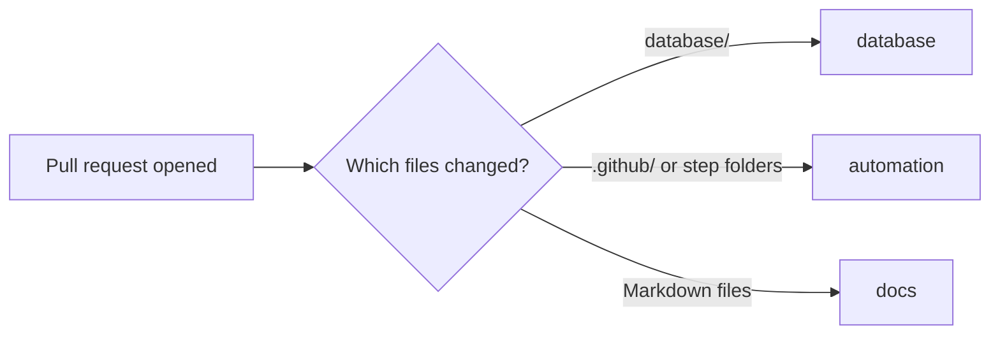

# Labels

Labels tell us what a pull request or issue touches and whether it needs a DBA. Most of them get added for you.

## The labels we use

| Label | What it means | How it gets added |
|---|---|---|
| `database-change` | A request to change a database | The request form adds it |
| `needs-dba` | Waiting on a DBA to look at it | The request form adds it. Add it yourself to any pull request that needs a DBA. |
| `database` | The pull request changes files in `database/` | Added automatically by the labeler |
| `automation` | Workflows, scripts, or the project board | Added automatically for `.github/` and the step folders |
| `docs` | Documentation, including this wiki | Added automatically for Markdown files |
| `on-call` | Opened by on call for something broken | On call adds it during an incident |
| `schema-change` | A change to tables, columns, or constraints | Add it yourself |
| `dependencies` | Dependency updates, usually from Dependabot | Dependabot adds it |
| `good-first-try` | A small, safe change for someone new | Add it at triage |

## How automatic labels work

When you open a pull request, a workflow looks at which files changed and adds labels to match. The rules live in `.github/labeler.yml`.

Labels also drive the release notes. When we cut a release, GitHub groups the merged pull requests by label, so a good label means a clear changelog.
