# Maintenance and backups

What runs on its own every night and week, and when we're allowed to make changes.

## Maintenance window

Planned changes to production go out **Tuesday and Thursday between 8 PM and 10 PM Pacific**. High risk changes only go out in a window, and someone from the team has to be online for the whole thing.

Emergency fixes during an incident can go out any time. See [[Incident response SOP|Incident-Response-SOP]].

## Nightly schedule

All times are Pacific.

```mermaid
gantt
    title A normal night on sql-prod-01
    dateFormat HH:mm
    axisFormat %H:%M
    section Backups
    Log backups every 15 minutes :active, 00:00, 24h
    Full backup                 :01:00, 60m
    section Maintenance
    Index maintenance           :02:15, 45m
    Update statistics           :03:00, 30m
    section Checks
    Nightly database tests      :01:17, 15m
```

| Job | When | What it does |
|---|---|---|
| Log backup | Every 15 minutes | Lets us restore to any point in time |
| Full backup | 1:00 AM nightly | A complete copy of every database |
| Differential backup | 1:00 PM daily | Changes since the last full backup |
| Index maintenance | 2:15 AM nightly | Rebuilds or reorganizes fragmented indexes |
| Update statistics | 3:00 AM nightly | Keeps query plans accurate |
| `DBCC CHECKDB` | 4:00 AM Sunday | Checks every database for corruption |
| Nightly database tests | 09:17 UTC, about 1 to 2 AM Pacific | Runs the same tests as every pull request on a throwaway SQL Server in GitHub, and opens an issue if they fail |

## Backups

| | Target |
|---|---|
| How much data we can lose (RPO) | 15 minutes |
| How fast we're back up (RTO) | 1 hour for DemoShop |
| How long we keep backups | 35 days on disk, 1 year in cold storage |

A backup you've never restored isn't a backup yet. On the first Monday of every month, the on-call DBA restores last night's full backup to `sql-test-01`, runs `DBCC CHECKDB` on it, and notes the result in an issue with the `on-call` label.
