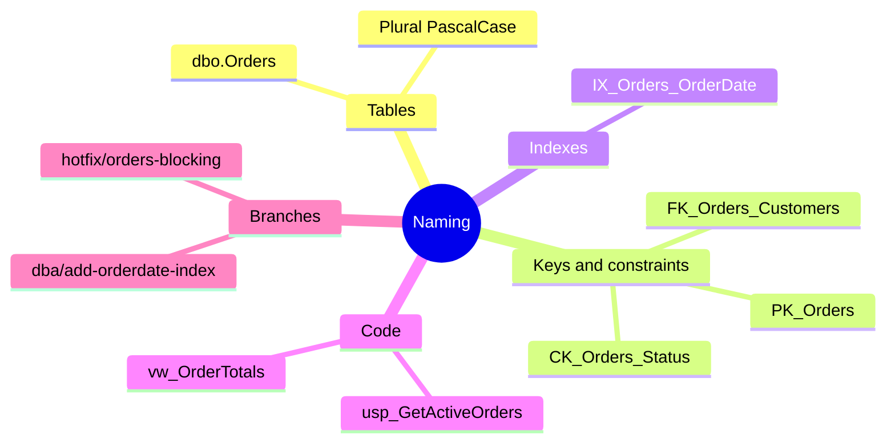

# Naming conventions

Consistent names mean you can guess what something is without opening it. When you're looking at a blocking chain at 2 AM, that matters.

## Database objects

| Object | Pattern | Example |
|---|---|---|
| Table | `schema.PluralNoun` in PascalCase | `dbo.Orders`, `dbo.Customers` |
| Column | PascalCase. IDs are the singular table name plus `Id`. | `OrderId`, `CustomerId`, `OrderDate` |
| Primary key | `PK_Table` | `PK_Orders` |
| Foreign key | `FK_ChildTable_ParentTable` | `FK_Orders_Customers` |
| Check constraint | `CK_Table_Column` | `CK_Orders_Status` |
| Default constraint | `DF_Table_Column` | `DF_Customers_CreatedAt` |
| Index | `IX_Table_Column1_Column2` | `IX_Orders_OrderDate` |
| Unique index | `UX_Table_Column` | `UX_Customers_Email` |
| Stored procedure | `usp_VerbNoun` | `dbo.usp_GetActiveOrders` |
| View | `vw_Noun` | `dbo.vw_OrderTotals` |
| Function | `fn_VerbNoun` | `dbo.fn_GetOrderTotal` |

A few rules that apply everywhere.

- Always use the schema, like `dbo.Orders`, never just `Orders`.
- Don't start procs with `sp_`. SQL Server checks `master` first for those.
- No spaces, no special characters, and no abbreviations that only you understand.
- Never name a constraint by letting SQL Server pick it. Auto-generated names are different on every server, which makes rollback scripts painful.

## Files and folders

| What | Where | Example |
|---|---|---|
| Table scripts | `database/schema/`, numbered in deploy order | `02-orders.sql` |
| Procs | `database/procs/`, named after the proc | `usp_GetActiveOrders.sql` |
| Rollback scripts | `database/rollback/`, same name as what they undo | `usp_GetActiveOrders.sql` |
| Tests | `database/tests/`, starting with `test-` and saying what they check | `test-active-orders-only.sql` |
| Seed data | `database/seed/`, numbered | `01-sample-data.sql` |

## Branches

Branch names say who or what is making the change and what it is.

| Kind of change | Pattern | Example |
|---|---|---|
| Normal change | `dba/short-description` | `dba/add-orderdate-index` |
| Fix during an incident | `hotfix/short-description` | `hotfix/orders-blocking` |
| Docs only | `docs/short-description` | `docs/update-on-call` |
| Made by Copilot | `copilot/...` | Copilot picks the name |

