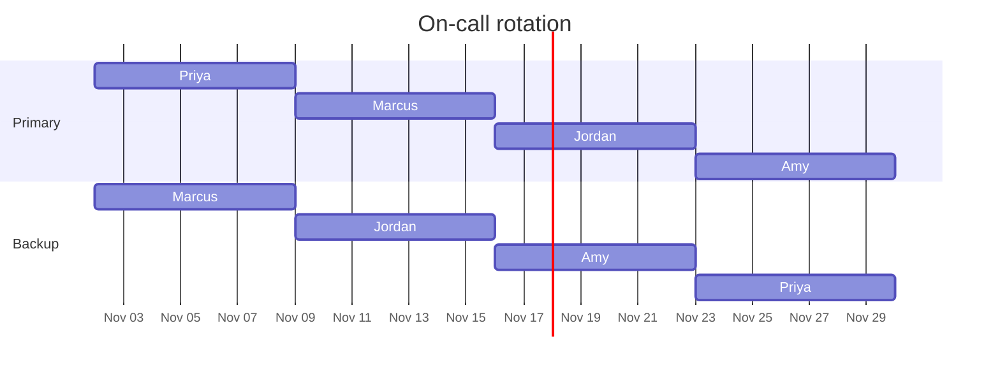

# On-call rotation

One DBA is on call at a time, for a week. The shift runs from Monday at 9:30 AM to the next Monday at 9:30 AM, and hands off at standup.

## Schedule

| Week of | Primary | Backup |
|---|---|---|
| Nov 2, 2026 | Priya | Marcus |
| Nov 9, 2026 | Marcus | Jordan |
| Nov 16, 2026 | Jordan | Amy |
| Nov 23, 2026 | Amy | Priya |

Need to swap a week? Trade with someone, then open a pull request that updates this table. Both of you should approve it.

## What on call means

- Answer a page within 15 minutes, day or night.
- Keep your laptop and a working VPN with you.
- Watch the nightly checks. If one fails, it opens an issue with the `automation` and `needs-dba` labels. Look at it first thing.
- Handle anything urgent with the [[Incident response SOP|Incident-Response-SOP]].
- Normal requests on the board can wait for business hours.

## Escalation

If you can't fix it, or you're not sure, call for help. Nobody gets in trouble for escalating.

| After | Call |
|---|---|
| 15 minutes with no progress | Backup on call |
| 30 minutes, or any SEV 1 | Amy, team lead |
| Data loss, or a possible security issue | Amy, plus the security team |

## Handoff checklist

Go through this at Monday standup before you hand off.

- [ ] Any open incidents or `on-call` issues, and where they stand
- [ ] Anything that paged more than once
- [ ] Changes going out this week that might cause trouble
- [ ] Anything you fixed by hand that should become a runbook or get automated
