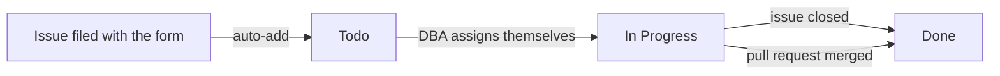

# Project board

All of our work is tracked on the **Database Work** board. If it's not on the board, we're not working on it.

**[Open the Database Work board](https://github.com/users/amyabelsql/projects/11)**

## Columns

| Column | What it means |
|---|---|
| Todo | Filed and waiting for triage or a DBA to pick it up |
| In Progress | A DBA is working on it, usually with an open pull request |
| Done | Merged and deployed, or closed |

Most cards move on their own. A new request with the `database-change` label gets added to the board automatically. When the issue closes or its pull request merges, the card moves to Done.

## Fields

Every card has two extra fields that a DBA fills in at triage.

**Server** is where the change runs, like `sql-prod-01`.

**Risk** tells us how careful we need to be.

| Risk | What it means | Example |
|---|---|---|
| Low | Can't break anything for users. Easy to undo. | Adding a permission, creating a new proc |
| Medium | Could slow things down or affect one app | A new index on a busy table |
| High | Could cause downtime or data loss | Changing a column type, a large data fix |

High risk changes need two approvals and go out in a maintenance window. See [[Deployment runbook|Deployment-Runbook]].

## Weekly triage

Every Monday at 9:30 AM we go through the Todo column together. For each new card we set Server and Risk, pick an owner, and close anything that's a duplicate or not ours.
