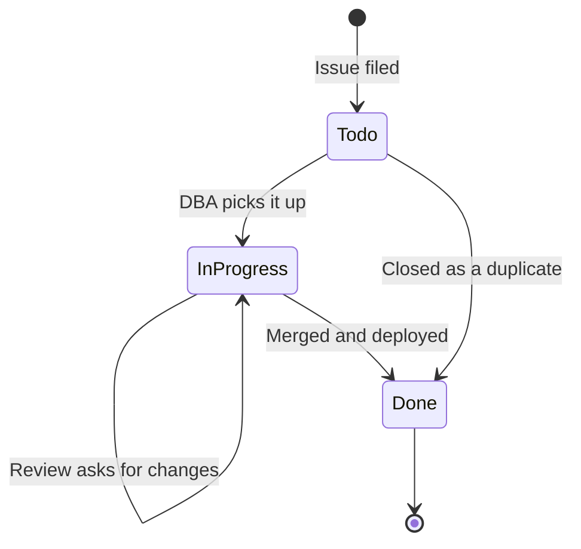

# Request a database change

If you need something changed in a database, file a request. Please don't DM a DBA or send an email. Requests in chat get lost, and the form makes sure we have everything we need the first time.

**[File a database change request](https://github.com/amyabelsql/DayOfData_Portland_2026/issues/new?template=database-change.yml)**

## When to file one

File a request for any of these.

- A new table, column, index, or constraint
- A new or changed stored procedure, view, or function
- A data fix, like updating or deleting rows in production
- A permission change, like giving an app account access to a schema

You don't need a request to read data in a dev or test environment. If production is down or broken right now, skip the form and follow the [[Incident response SOP|Incident-Response-SOP]].

## Filling out the form

| Field | What we need | Good example | Not so good |
|---|---|---|---|
| Server | The exact server name | `sql-prod-01` | "prod" |
| Database | The database name | `DemoShop` | "the orders one" |
| Type of change | Pick the closest one | Index | Other |
| What and why | What should change and the problem it solves | "Add an index on `dbo.Orders.OrderDate`. The daily sales report times out." | "Make it faster" |
| Rollback plan | How we undo it if it goes wrong | "Drop the index." | "N/A" |
| When can this run | Any timing limits | "Any weeknight after 8 PM" | Left blank on a big change |

Every field except the last one is required, and you can't submit without them. That's on purpose.

## What happens next

1. Your issue gets the `database-change` and `needs-dba` labels automatically.
2. It shows up in the **Todo** column on the [project board](https://github.com/users/amyabelsql/projects/11).
3. At Monday triage, a DBA sets the **Server** and **Risk** fields and picks it up.
4. The DBA opens a pull request that links back to your issue. You'll get a notification.
5. Once it's deployed, the issue closes and the card moves to **Done**.

## How long it takes

These are targets, not promises. Anything marked High risk may wait for the next maintenance window.

| Type of change | Usual turnaround |
|---|---|
| Permissions | 1 business day |
| Index | 2 to 3 business days |
| Schema | About a week, including review |
| Data fix | Depends on size. Small fixes are usually 1 to 2 days. |
