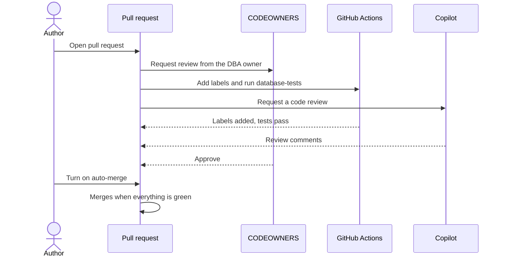

# Reviewing pull requests

Every change to `main` goes through a pull request. Nobody pushes straight to `main`, including DBAs. This page covers what needs a DBA, what we look for, and how to approve.

## What needs a DBA

If your pull request touches anything in the left column, it needs a DBA to approve it. Add the `needs-dba` label so it shows up in our queue.

| Change | Needs a DBA? | Labels |
|---|---|---|
| New or changed table, column, or constraint | Yes | `database`, `schema-change`, `needs-dba` |
| New or changed index | Yes | `database`, `needs-dba` |
| New or changed proc, view, or function | Yes | `database`, `needs-dba` |
| Data fix that updates or deletes rows | Yes, and Risk is at least Medium | `database`, `needs-dba` |
| Permission or role change | Yes | `database`, `needs-dba` |
| Test or rollback script only | Yes, but it's quick | `database` |
| Workflow or pipeline change in `.github/` | Yes, the CODEOWNER reviews it | `automation` |
| Docs or wiki only | No, any teammate can approve | `docs` |

You don't have to remember the CODEOWNER part. Anything under `database/` or `.github/` automatically requests a review from the owner listed in `.github/CODEOWNERS`.

## What every pull request needs

The pull request template has a checklist. Don't tick a box unless it's true.

- [ ] Tests pass
- [ ] Rollback script included in `database/rollback/`
- [ ] Safe to run twice

The `database-tests` check must be green before anything can merge. It builds a fresh SQL Server, deploys everything, and runs every test in `database/tests/`.

## What a DBA looks for

- Objects are schema-qualified, like `dbo.Orders`, never just `Orders`.
- Procs, views, and functions use `CREATE OR ALTER`.
- Every proc starts with `SET NOCOUNT ON`.
- Creates are guarded with `IF OBJECT_ID(...) IS NULL` or `IF NOT EXISTS`, so the script is safe to run twice.
- Names follow the [[Naming conventions|Naming-Conventions]].
- New indexes are worth it. Check for an existing index that already covers the query.
- Big updates or deletes run in batches so they don't block users or blow up the log.
- There's a test that would fail if the change were wrong.
- There are no passwords, keys, or connection strings anywhere in the change.

## How to approve

1. Open the pull request and go to **Files changed**.
2. Read every file. Leave a comment on any line you have a question about.
3. Click **Review changes** in the top right.
4. Pick one of these.
    - **Approve** if it's ready to go.
    - **Request changes** if something has to be fixed first.
    - **Comment** if you have questions but aren't blocking it.
5. Click **Submit review**.

Once it's approved and `database-tests` is green, the author turns on auto-merge and it merges by itself. Copilot also leaves a review on every pull request. Treat it like a helpful second opinion, not a replacement for a DBA.

## What happens when you open one

On this demo repo, required approvals are set to 0 so one person can run the whole talk. On a real team, set it to at least 1.
