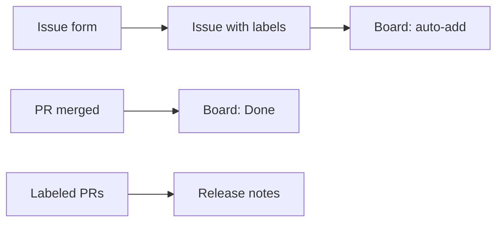

# 04 · Templates, issues, and boards

**The big idea:** the busy work of tracking requests can run itself. Requests show up complete, and the board keeps itself current.

## Why it matters
No more "which server?" emails. The form asks for server, database, the change, and the rollback plan before anyone hits submit.

## Run it
    pwsh ./04_TemplatesIssuesBoard/run.ps1

## What you'll see
1. A project board called "Database Work", linked to the repo.
2. Two custom fields: Server and Risk.
3. Six realistic DBA requests, placed across Todo, In Progress, and Done.
4. Release `v1.0.0`, with notes GitHub wrote from the labeled pull requests.
5. The issue form, the board, and the release open in the browser.
6. Two one-time clicks the API can't do yet.

## How it works

- [database-change.yml](../.github/ISSUE_TEMPLATE/database-change.yml) is the issue form.
- [config.yml](../.github/ISSUE_TEMPLATE/config.yml) turns off blank issues.
- [release.yml](../.github/release.yml) groups release notes by label.
- [sample-issues.json](sample-issues.json) holds the sample requests.
- [run.ps1](run.ps1) builds it all.

**The one-time clicks** (the script prints these too):
1. On the board, switch the layout to **Board**.
2. Board menu (...) > **Workflows**. Turn on **Auto-add to project** with `label:database-change`, **Item closed** to Done, and **Pull request merged** to Done.

## Play with it
- File a live issue from the form and watch it land on the board.
- Make the Rollback plan field optional and see the form change.
- Add a sample issue to `sample-issues.json` and run the script again.

## Learn more
- [Syntax for issue forms](https://docs.github.com/en/communities/using-templates-to-encourage-useful-issues-and-pull-requests/syntax-for-issue-forms)
- [Using the built-in automations](https://docs.github.com/en/issues/planning-and-tracking-with-projects/automating-your-project/using-the-built-in-automations)
- [Automatically generated release notes](https://docs.github.com/en/repositories/releasing-projects-on-github/automatically-generated-release-notes)
