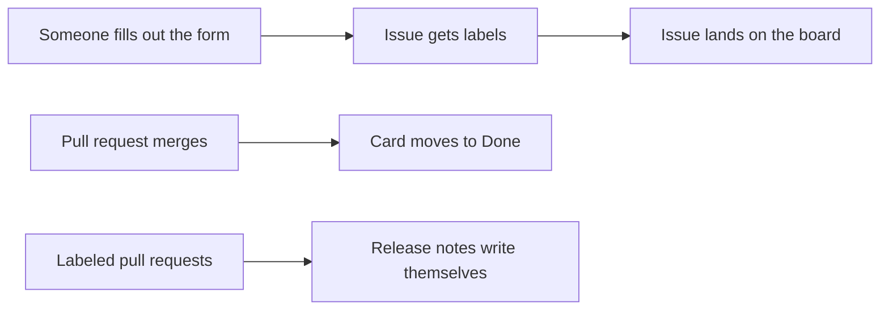

# 04 · Issue forms and a project board

Tracking requests is a lot of busy work, and most of it can run on its own. Requests show up with everything you need, and the board keeps itself up to date.

If you've ever had to email someone back to ask "which server?", this one's for you. The issue form asks for the server, the database, the change, and the rollback plan before anyone can hit submit.

## Run it
```powershell
pwsh ./04_TemplatesIssuesBoard/run.ps1
```

## What happens
1. A project board called "Database Work" gets created and linked to the repo.
2. Two custom fields get added to the board, Server and Risk.
3. Six realistic DBA requests get filed and spread across Todo, In Progress, and Done.
4. Release `v1.0.0` gets published. GitHub writes the release notes for you from the labels on the merged pull requests.
5. The issue form, the board, and the release all open in the browser.
6. The script prints two clicks you have to do yourself, because GitHub's API can't do them yet.

## The files
- [database-change.yml](../.github/ISSUE_TEMPLATE/database-change.yml) is the issue form people fill out.
- [config.yml](../.github/ISSUE_TEMPLATE/config.yml) turns off blank issues, so everyone has to use the form.
- [release.yml](../.github/release.yml) tells GitHub how to group the release notes by label.
- [sample-issues.json](sample-issues.json) holds the six sample requests.
- [run.ps1](run.ps1) builds everything above.

Here's how the pieces connect.



## Two clicks you do once
The script prints these too.

1. On the board, switch the layout to **Board**.
2. Open the board menu (...) and pick **Workflows**. Turn on **Auto-add to project** with `label:database-change`, then set **Item closed** and **Pull request merged** to move cards to Done.

## Try it yourself
- File a real issue from the form and watch it land on the board.
- Make the rollback plan field optional and see how the form changes.
- Add your own request to `sample-issues.json` and run the script again.

## Want to dig deeper?
- [Syntax for issue forms](https://docs.github.com/en/communities/using-templates-to-encourage-useful-issues-and-pull-requests/syntax-for-issue-forms) shows every kind of field you can put on a form.
- [Using the built-in automations](https://docs.github.com/en/issues/planning-and-tracking-with-projects/automating-your-project/using-the-built-in-automations) covers the board workflows from the two clicks above.
- [Automatically generated release notes](https://docs.github.com/en/repositories/releasing-projects-on-github/automatically-generated-release-notes) explains how GitHub writes the notes.
