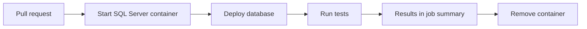

# 05 · A fresh SQL Server every time

**The big idea:** every change gets tested on a clean server, and nobody has to remember to do it.

## Why it matters
"It worked on my machine" isn't a deploy plan. A brand new SQL Server for every pull request means the tests always start from a known state.

## Run it
    pwsh ./05_Containers/run.ps1

Then, to show it on a pull request:

    pwsh ./05_Containers/break-it.ps1
    pwsh ./05_Containers/fix-it.ps1

## What you'll see
1. SQL Server 2022 starts in a container.
2. The script waits until it answers.
3. The DemoShop database deploys: create, schema, procs, seed.
4. Each test prints PASS or FAIL.
5. `break-it.ps1` removes the `WHERE` line from the proc, opens a pull request, and the check goes red with a clear message.
6. `fix-it.ps1` puts the line back on the same pull request, and the check goes green.

## How it works

- [05-database-tests.yml](../.github/workflows/05-database-tests.yml) runs on every pull request. Its password is made at run time and masked.
- [compose.yaml](../compose.yaml) is the local SQL Server. The password comes from `.env`.
- [scripts/](../scripts/) holds the wait, deploy, and test scripts. Local and Actions use the same ones.
- [database/tests/](../database/tests/) holds the tests. Each one `THROW`s with a `FAIL:` message.

## Play with it
- Change a seed row to `Status = 'Active'` and run the tests.
- Write a new test that checks every order has a `Total` over 0.
- Run `docker compose down` and then `run.ps1` again. It starts from nothing.

## Learn more
- [Quickstart: SQL Server Linux containers with Docker](https://learn.microsoft.com/en-us/sql/linux/quickstart-install-connect-docker)
- [Download and install sqlcmd](https://learn.microsoft.com/en-us/sql/tools/sqlcmd/sqlcmd-download-install)
- [Masking a value in a log](https://docs.github.com/en/actions/reference/workflows-and-actions/workflow-commands#masking-a-value-in-a-log)
