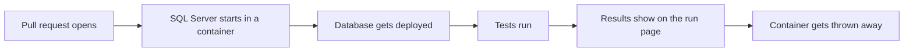

# 05 · Test every change in a SQL Server container

Every change gets tested on a brand new SQL Server, and nobody has to remember to do it.

"It worked on my machine" isn't a deploy plan. When every pull request gets its own clean SQL Server, the tests always start from the same place. If a test fails, it's because of the change, not because of something left over on a shared dev box.

## Run it
```powershell
pwsh ./05_Containers/run.ps1
```

To show what happens on a real pull request, run these two after it. First break the proc.

```powershell
pwsh ./05_Containers/break-it.ps1
```

Then fix it.

```powershell
pwsh ./05_Containers/fix-it.ps1
```

## What happens
1. SQL Server 2022 starts in a container.
2. The script waits until SQL Server is ready to answer.
3. The DemoShop database gets deployed. That means the create, the schema, the procs, and the sample data, in that order.
4. Each test prints PASS or FAIL.
5. `break-it.ps1` removes the `WHERE` line from the proc and opens a pull request. The check turns red and tells you exactly what broke.
6. `fix-it.ps1` puts the line back on that same pull request, and the check turns green.

## The files
- [05-database-tests.yml](../.github/workflows/05-database-tests.yml) is the workflow that runs on every pull request. It makes a new password each time it runs and hides it in the logs.
- [compose.yaml](../compose.yaml) runs SQL Server on your laptop. It reads the password from your `.env` file.
- [scripts/](../scripts/) has the scripts that wait for SQL Server, deploy the database, and run the tests. Your laptop and GitHub use the exact same ones.
- [database/tests/](../database/tests/) holds the tests. When one fails, it `THROW`s an error that starts with `FAIL:`.

Here's what happens on every pull request.



## Try it yourself
- Change one of the sample rows to `Status = 'Active'` and run the tests.
- Write a new test that checks every order has a `Total` over 0.
- Tear everything down, then run `run.ps1` again. It builds everything from nothing.
  ```powershell
  docker compose down
  ```

## Want to dig deeper?
- [SQL Server Linux containers with Docker](https://learn.microsoft.com/en-us/sql/linux/quickstart-install-connect-docker) is Microsoft's quickstart for running SQL Server in Docker.
- [Download and install sqlcmd](https://learn.microsoft.com/en-us/sql/tools/sqlcmd/sqlcmd-download-install) covers the command line tool the scripts use.
- [Masking a value in a log](https://docs.github.com/en/actions/reference/workflows-and-actions/workflow-commands#masking-a-value-in-a-log) shows how the password stays out of the logs.
