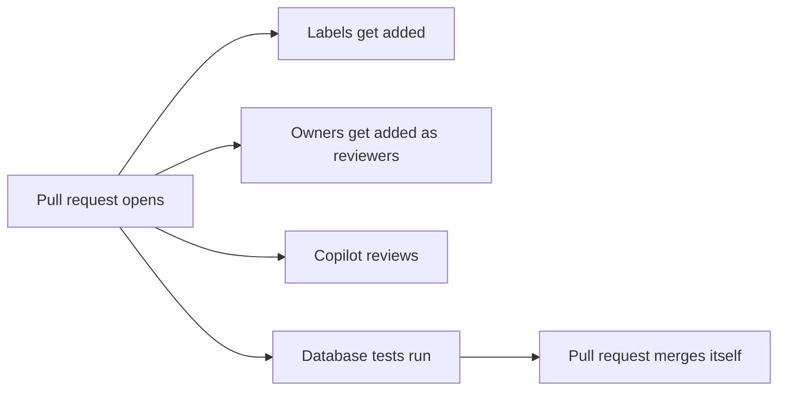

# 06 · Copilot and pull requests that run themselves

A pull request can take care of its own chores, and Copilot can write the first draft for you.

Adding labels, picking reviewers, waiting on checks, and clicking merge are all chores. Let the pull request handle them, and spend your review time actually reading the SQL.

## Run it
Copilot takes a few minutes to do its work, so run this one before the talk.

```powershell
pwsh ./06_CopilotAndPRs/copilot-task.ps1
```

Then run this one on stage.

```powershell
pwsh ./06_CopilotAndPRs/run.ps1
```

## What happens
1. A branch gets created with a new proc, `dbo.usp_GetCustomerOrderCount`, along with its test and rollback script.
2. A pull request opens with the checklist already filled in.
3. Labels show up on their own.
4. Copilot gets asked to review the code.
5. The checks start running.
6. Auto-merge turns on. Once `database-tests` passes, the pull request merges itself.

## The files
- [CODEOWNERS](../.github/CODEOWNERS) says who owns `/database/` and `/.github/`. Those people get added as reviewers automatically.
- [pull_request_template.md](../.github/pull_request_template.md) is the checklist every pull request starts with.
- [labeler.yml](../.github/labeler.yml) and [06-labeler.yml](../.github/workflows/06-labeler.yml) add labels based on which files changed.
- [06-dependabot-auto-merge.yml](../.github/workflows/06-dependabot-auto-merge.yml) merges small Dependabot patch updates without anyone clicking anything. Dependabot itself is set up in `.github/dependabot.yml`, which step 00 adds.
- [copilot-instructions.md](../.github/copilot-instructions.md) holds the house rules Copilot follows when it writes or reviews code here.
- [copilot-task.ps1](copilot-task.ps1) files [copilot-issue.md](copilot-issue.md) as an issue and assigns it to Copilot.

Here's everything that kicks off when a pull request opens.



## Try it yourself
- Remove `SET NOCOUNT ON` from the new proc and see if Copilot's review catches it.
- Add a rule of your own to `copilot-instructions.md` and ask Copilot to review again.
- Add a new label rule to `labeler.yml`.

## Want to dig deeper?
- [About code owners](https://docs.github.com/en/repositories/managing-your-repositorys-settings-and-features/customizing-your-repository/about-code-owners) explains how the CODEOWNERS file works.
- [Using Copilot code review](https://docs.github.com/en/copilot/how-tos/use-copilot-agents/request-a-code-review/use-code-review) shows how to ask Copilot for a review.
- [About the Copilot coding agent](https://docs.github.com/en/copilot/concepts/agents/coding-agent/about-coding-agent) covers handing an issue to Copilot.
- [Automating Dependabot with GitHub Actions](https://docs.github.com/en/code-security/dependabot/working-with-dependabot/automating-dependabot-with-github-actions) explains the auto-merge setup.
