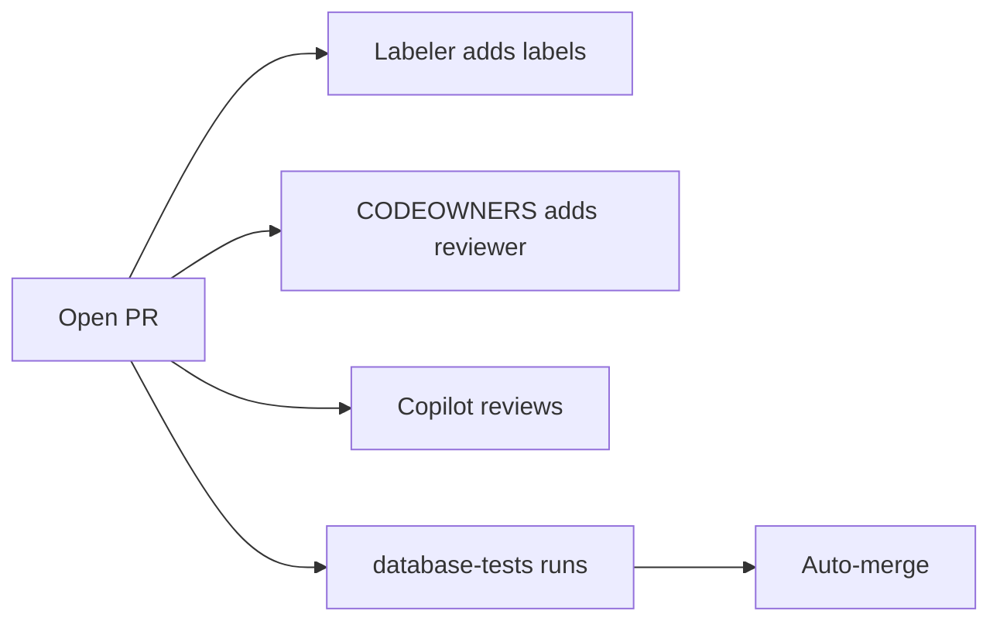

# 06 · Where Copilot helps, PRs that run themselves

**The big idea:** the pull request can do its own chores, and Copilot can take the first pass.

## Why it matters
Labels, reviewers, checks, and the merge button are all chores. Hand them to the pull request and spend your review time on the SQL.

## Run it
Before the talk, because Copilot takes a few minutes:

    pwsh ./06_CopilotAndPRs/copilot-task.ps1

On stage:

    pwsh ./06_CopilotAndPRs/run.ps1

## What you'll see
1. A branch with a new proc, `dbo.usp_GetCustomerOrderCount`, plus its test and rollback script.
2. A pull request with the checklist already filled in.
3. Labels appear on their own.
4. Copilot is asked to review.
5. Checks start running.
6. Auto-merge turns on, and the pull request merges itself once `database-tests` passes.

## How it works

- [CODEOWNERS](../.github/CODEOWNERS) owns `/database/` and `/.github/`.
- [pull_request_template.md](../.github/pull_request_template.md) is the checklist.
- [labeler.yml](../.github/labeler.yml) and [06-labeler.yml](../.github/workflows/06-labeler.yml) add labels by path.
- [06-dependabot-auto-merge.yml](../.github/workflows/06-dependabot-auto-merge.yml) merges Dependabot patch updates on its own. Dependabot itself is set up in `.github/dependabot.yml`, added by step 00.
- [copilot-instructions.md](../.github/copilot-instructions.md) holds the house rules Copilot follows.
- [copilot-task.ps1](copilot-task.ps1) files [copilot-issue.md](copilot-issue.md) and assigns it to Copilot.

## Play with it
- Remove `SET NOCOUNT ON` from the new proc and see if Copilot's review catches it.
- Add a rule to `copilot-instructions.md` and ask Copilot to review again.
- Add a new label rule to `labeler.yml`.

## Learn more
- [About code owners](https://docs.github.com/en/repositories/managing-your-repositorys-settings-and-features/customizing-your-repository/about-code-owners)
- [Using Copilot code review](https://docs.github.com/en/copilot/how-tos/use-copilot-agents/request-a-code-review/use-code-review)
- [About Copilot coding agent](https://docs.github.com/en/copilot/concepts/agents/coding-agent/about-coding-agent)
- [Automating Dependabot with GitHub Actions](https://docs.github.com/en/code-security/dependabot/working-with-dependabot/automating-dependabot-with-github-actions)
