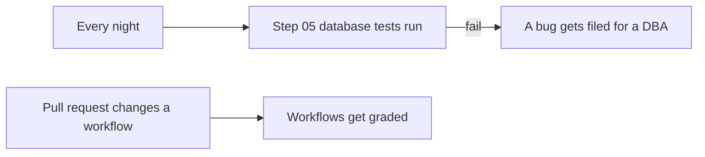

# 07 · Guardrails for safe workflows

A little chaos is fun on stage. In production, you want a safety net.

A workflow is code that runs with your permissions, so it deserves the same care as anything else you deploy. Five small habits prevent most of the bad days. Pin your actions, give jobs only the permissions they need, set timeouts, use concurrency groups, and keep secrets out of files.

## Run it
```powershell
pwsh ./07_Guardrails/run.ps1
```

## What happens
1. `risky-workflow.yml` gets graded and fails every rule.
2. The real workflows in this repo get graded and pass every rule.
3. The nightly check starts with `simulate_failure=true`, so it fails on purpose.
4. The failure files a bug on its own, and that issue opens in the browser.

## The files
- [Test-Guardrails.ps1](Test-Guardrails.ps1) grades workflow files and prints a scorecard. Use `-Path` to point it at a different file or folder.
- [examples/risky-workflow.yml](examples/risky-workflow.yml) breaks every rule on purpose. It's not in `.github/workflows`, so GitHub never runs it.
- [07-guardrails-check.yml](../.github/workflows/07-guardrails-check.yml) grades the workflows on any pull request that changes them.
- [07-nightly-check.yml](../.github/workflows/07-nightly-check.yml) runs the step 05 tests every night and files a bug if they fail.

Here's how the two checks work.



## The five rules

| Rule | Why you want it |
|---|---|
| Pin actions to a full commit SHA | Someone can move a tag to different code. A SHA always points to the same code. |
| Add a `permissions:` block | The job only gets the access it actually needs. |
| Set `timeout-minutes` on every job | A stuck job stops instead of running for hours. |
| Add a `concurrency` group | Two runs of the same workflow don't step on each other. |
| Never put secrets in plain text | They can't leak through a fork or a log. |

One thing to know about the nightly check. GitHub turns off scheduled workflows in public repos after 60 days with no activity, so you may need to turn it back on.

## Try it yourself
- Fix one rule in `risky-workflow.yml` and grade it again.
- Remove `timeout-minutes` from a real workflow and open a pull request. The guardrails check will catch it.
- Run the nightly check without `simulate_failure` and notice that no issue gets filed.

## Want to dig deeper?
- [Security hardening for GitHub Actions](https://docs.github.com/en/actions/reference/security/secure-use) is GitHub's full guide to keeping workflows safe.
- [Reusing workflows](https://docs.github.com/en/actions/how-tos/reuse-automations/reuse-workflows) explains how the nightly check calls the step 05 tests.
- [Disabling and enabling a workflow](https://docs.github.com/en/actions/how-tos/manage-workflow-runs/disable-and-enable-workflows) shows how to turn a scheduled workflow back on.
