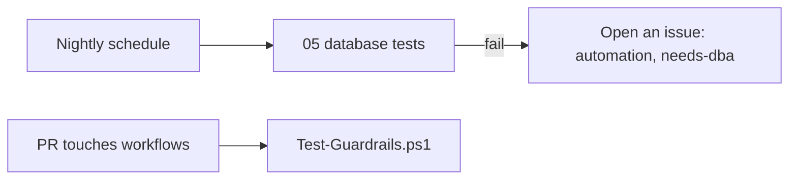

# 07 · Guardrails I add every time

**The big idea:** a little chaos is fun on stage. In production, you want a safety net.

## Why it matters
A workflow is code that runs with your permissions. Five small habits stop most of the bad days: pinned actions, least permissions, timeouts, concurrency, and no secrets in files.

## Run it
    pwsh ./07_Guardrails/run.ps1

## What you'll see
1. `risky-workflow.yml` gets graded and comes back all red.
2. The real workflows get graded and come back all green.
3. The nightly check starts with `simulate_failure=true` and goes red.
4. The issue it filed on its own opens in the browser.

## How it works

- [Test-Guardrails.ps1](Test-Guardrails.ps1) grades workflow files and prints a scorecard. Use `-Path` to grade a different file or folder.
- [examples/risky-workflow.yml](examples/risky-workflow.yml) breaks every rule on purpose. It's not in `.github/workflows`, so it never runs.
- [07-guardrails-check.yml](../.github/workflows/07-guardrails-check.yml) grades workflows on every pull request that changes them.
- [07-nightly-check.yml](../.github/workflows/07-nightly-check.yml) calls the step 05 tests each night and files a bug if they fail.

| Rule | Why |
|---|---|
| Pin actions to a full commit SHA | A tag can be moved. A SHA can't. |
| `permissions:` block | The job gets only the access it needs. |
| `timeout-minutes` on every job | A stuck job can't burn hours. |
| `concurrency` group | Two runs don't step on each other. |
| No plain-text secrets | A fork or a log never leaks them. |

GitHub turns off scheduled workflows in public repos after 60 days with no activity.

## Play with it
- Fix one rule in `risky-workflow.yml` and grade it again.
- Remove `timeout-minutes` from a real workflow and open a pull request.
- Run the nightly check without `simulate_failure` and see no issue get filed.

## Learn more
- [Security hardening for GitHub Actions](https://docs.github.com/en/actions/reference/security/secure-use)
- [Reusing workflows](https://docs.github.com/en/actions/how-tos/reuse-automations/reuse-workflows)
- [Disabling and enabling a workflow](https://docs.github.com/en/actions/how-tos/manage-workflow-runs/disable-and-enable-workflows)
