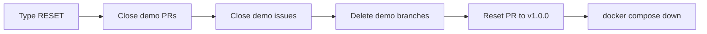

# 99 · After the talk

**The big idea:** leave it ready for the next run.

## Why it matters
The best demo is one you can run again tomorrow without thinking about it.

## Run it
    pwsh ./99_Cleanup/run.ps1

## What you'll see
1. A prompt to type `RESET`. Nothing changes until you do.
2. Demo pull requests close (`demo/*` and `copilot/*` branches).
3. Demo issues close. The sample issues from step 04 stay on the board.
4. Leftover `demo/*` branches get deleted.
5. `database/` on `main` goes back to how it was at `v1.0.0`, through a normal pull request.
6. The local SQL Server container stops.

## How it works

- [run.ps1](run.ps1) does it all. The seeded history and the `v1.0.0` release are never touched.

## Play with it
- Run it twice. The second run has nothing to do.
- Run step 06, then this, and check that the new proc is gone from `main`.

## Learn more
- [gh issue close](https://cli.github.com/manual/gh_issue_close)
- [gh pr close](https://cli.github.com/manual/gh_pr_close)
