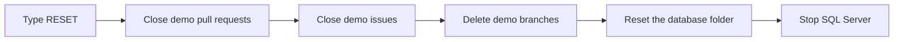

# 99 · Clean up after the talk

This puts the repo back the way it was so you can run the whole talk again tomorrow without thinking about it.

## Run it
```powershell
pwsh ./99_Cleanup/run.ps1
```

## What happens
1. The script asks you to type `RESET`. Nothing changes until you do.
2. Demo pull requests get closed. Those are the ones from `demo/*` and `copilot/*` branches.
3. Demo issues get closed. The sample issues from step 04 stay on the board.
4. Any leftover `demo/*` branches get deleted.
5. The `database/` folder on `main` goes back to how it looked at `v1.0.0`. This happens through a normal pull request, so the rules from step 00 still apply.
6. The SQL Server container on your laptop stops.

## The files
- [run.ps1](run.ps1) does all of it. It never touches the seeded history from step 00 or the `v1.0.0` release.

Here's the order things happen in.



## Try it yourself
- Run it twice. The second time there's nothing left to do.
- Run step 06, then run this, and check that the new proc is gone from `main`.

## Want to dig deeper?
- [gh issue close](https://cli.github.com/manual/gh_issue_close) and [gh pr close](https://cli.github.com/manual/gh_pr_close) are the two commands doing most of the work.
