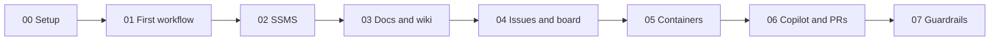

# GitHub, Automation, and a Little Bit of Chaos

The demo repo from my Day of Data Portland 2026 session. It shows how a SQL Server team can let GitHub handle the busy work: testing, tracking, reviews, and docs.

Every demo is a numbered folder, and every folder has one command. "DEMO 05" on a slide means the `05_Containers` folder.

## The flow

| Step folder | Slide | The big idea | Run this | What the room sees |
|---|---|---|---|---|
| [00_Prerequisites](00_Prerequisites/) | Before the talk | Get set up once | `./00_Prerequisites/run.ps1` | Nothing. This is your setup |
| [01_FirstWorkflow](01_FirstWorkflow/) | How a workflow works | A workflow is just a file | `./01_FirstWorkflow/run.ps1` | A workflow starts, runs, and reports back |
| [02_SSMS](02_SSMS/) | SSMS meets GitHub | Your scripts are code | `./02_SSMS/run.ps1` | A change made in SSMS turns into a pull request |
| [03_DocsWikiMermaid](03_DocsWikiMermaid/) | Docs that live with the code | Docs and diagrams are text | `./03_DocsWikiMermaid/run.ps1` | A full wiki with diagrams, published in seconds |
| [04_TemplatesIssuesBoard](04_TemplatesIssuesBoard/) | Templates, issues, and boards | Busy work runs itself | `./04_TemplatesIssuesBoard/run.ps1` | Issues and a project board that fill in on their own |
| [05_Containers](05_Containers/) | A fresh SQL Server every time | Every change gets tested | `./05_Containers/run.ps1` | SQL Server starts, the tests run, then it's gone |
| [06_CopilotAndPRs](06_CopilotAndPRs/) | Where Copilot helps, PRs that run themselves | The pull request does the chores | `./06_CopilotAndPRs/run.ps1` | A pull request that labels, reviews, and merges itself |
| [07_Guardrails](07_Guardrails/) | 60 days, Guardrails I add every time | Automation needs a safety net | `./07_Guardrails/run.ps1` | A checker that grades workflows, and a job that files its own bug |
| [99_Cleanup](99_Cleanup/) | After the talk | Reset for next time | `./99_Cleanup/run.ps1` | Nothing. The repo goes back to clean |

Run every command with `pwsh` from the repo root. Add `-Pause` to any `run.ps1` to wait for Enter between actions.

## Quick start

The fastest thing to try needs only Docker and PowerShell 7:

1. Fork this repo and clone your fork.
2. Install the tools listed in [00_Prerequisites](00_Prerequisites/README.md).
3. Run step 05 locally:

       pwsh ./05_Containers/run.ps1

   It makes a `.env` with a random password, starts SQL Server, deploys the database, and runs the tests.

To run the whole talk on your fork, run `pwsh ./00_Prerequisites/run.ps1` first.

To test everything that doesn't touch GitHub, as many times as you like:

    pwsh ./scripts/Test-Local.ps1 -Rounds 5

## Troubleshooting

- **Apple Silicon Mac:** in Docker Desktop, go to Settings > General and turn on "Use Rosetta for x86_64/amd64 emulation on Apple Silicon". SQL Server is an amd64 image.
- **SQL Server won't start:** the password has to be at least 8 characters and use three of: uppercase, lowercase, digits, symbols. Delete `.env` and run step 05 again to get a new one.
- **Port 1433 is busy:** stop the local SQL Server that's using it, or change the left side of `1433:1433` in `compose.yaml` and set `SQL_SERVER=localhost,<port>`.
- **`gh` says the project scope is missing:** run `gh auth refresh -s project`.

## What's where

| Path | What it is |
|---|---|
| `database/` | The DemoShop database: schema, procs, seed data, rollbacks, and tests |
| `scripts/` | Shared helpers every step uses |
| `compose.yaml` | Local SQL Server 2022 |
| `.github/` | Workflows, issue form, PR template, labeler, CODEOWNERS, and Copilot house rules |
| `BUILD_SPEC.md` | The spec this repo was built from |

MIT licensed. Fork it, break it, make it yours.
