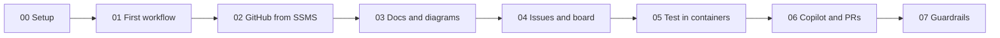

# GitHub, Automation, and a Little Bit of Chaos

This is the demo repo from my Day of Data Portland 2026 session. It shows how a SQL Server team can hand the busy work to GitHub, things like testing, tracking requests, reviews, and docs, and get back to the database work that actually needs a person.

Each demo lives in its own numbered folder and runs with one command. When a slide says "DEMO 05", that's the `05_Containers` folder.



## Try it in 2 minutes

All you need is [Docker Desktop](https://www.docker.com/products/docker-desktop/) and [PowerShell 7](https://learn.microsoft.com/en-us/powershell/scripting/install/installing-powershell).

1. Fork this repo and clone your fork.
2. Start Docker Desktop.
3. From the repo folder, run this.
   ```powershell
   pwsh ./05_Containers/run.ps1
   ```

SQL Server starts in a container, the DemoShop database gets deployed, and the tests run and pass.

## The steps

Click a step to open its README, which has the command to copy. Run every command from the repo folder.

| Step | What you'll see |
|---|---|
| [00 Set up your repo](00_Prerequisites/) | This sets up your repo once. |
| [01 Your first GitHub workflow](01_FirstWorkflow/) | A workflow starts, runs, and reports back |
| [02 Use GitHub from SSMS](02_SSMS/) | A change made in SSMS turns into a pull request |
| [03 Docs and diagrams in a wiki](03_DocsWikiMermaid/) | A wiki with a diagram on every page |
| [04 Issue forms and a project board](04_TemplatesIssuesBoard/) | An issue form and a project board that fill in on their own |
| [05 Test every change in a SQL Server container](05_Containers/) | SQL Server starts, the tests run, then it's gone |
| [06 Copilot and pull requests that run themselves](06_CopilotAndPRs/) | A pull request that labels, reviews, and merges itself |
| [07 Guardrails for safe workflows](07_Guardrails/) | A checker that grades workflows, and a job that files its own bug |
| [99 Clean up after the talk](99_Cleanup/) | Nothing on screen. This resets the repo for next time. |

Add `-Pause` to any command if you want it to stop and wait for you to press Enter between actions. It's handy when you're presenting.

## Run the whole talk on your fork

1. Install the tools listed in [00 Set up your repo](00_Prerequisites/README.md).
2. Sign in to GitHub, then give the CLI the `project` permission.
   ```powershell
   gh auth login
   ```
   ```powershell
   gh auth refresh -s project
   ```
3. Set up your repo.
   ```powershell
   pwsh ./00_Prerequisites/run.ps1
   ```
4. Publish the wiki.
   ```powershell
   pwsh ./03_DocsWikiMermaid/run.ps1
   ```
5. Build the board, then do the two clicks it prints.
   ```powershell
   pwsh ./04_TemplatesIssuesBoard/run.ps1
   ```
6. Run each demo in order. Step 06 needs Copilot to do some work first, so start this a few minutes before you get there.
   ```powershell
   pwsh ./06_CopilotAndPRs/copilot-task.ps1
   ```
   Then run the demos.
   ```powershell
   pwsh ./01_FirstWorkflow/run.ps1
   ```
   ```powershell
   pwsh ./02_SSMS/run.ps1 -Pause
   ```
   ```powershell
   pwsh ./03_DocsWikiMermaid/run.ps1
   ```
   ```powershell
   pwsh ./04_TemplatesIssuesBoard/run.ps1
   ```
   ```powershell
   pwsh ./05_Containers/run.ps1
   ```
   ```powershell
   pwsh ./06_CopilotAndPRs/run.ps1
   ```
   ```powershell
   pwsh ./07_Guardrails/run.ps1
   ```
7. Clean up when you're done.
   ```powershell
   pwsh ./99_Cleanup/run.ps1
   ```

## See it on GitHub

- [Wiki](https://github.com/amyabelsql/DayOfData_Portland_2026/wiki)
- [Project board](https://github.com/users/amyabelsql/projects)
- [Actions](https://github.com/amyabelsql/DayOfData_Portland_2026/actions)

## If something goes wrong

- **On an Apple Silicon Mac,** open Docker Desktop, go to Settings > General, and turn on "Use Rosetta for x86_64/amd64 emulation on Apple Silicon".
- **If SQL Server won't start,** check the password. It needs at least 8 characters and three of the four types, which are uppercase, lowercase, numbers, and symbols. Delete `.env` and run step 05 again to get a new one.
- **If port 1433 is already in use,** stop the other SQL Server on your machine. Or change `"1433:1433"` in `compose.yaml` to `"1434:1433"` and run this before step 05.
  ```powershell
  $env:SQL_SERVER = 'localhost,1434'
  ```
- **If gh says the project scope is missing,** run this.
  ```powershell
  gh auth refresh -s project
  ```

## Test it

This runs everything that works on your laptop and makes sure it all still passes. 
```powershell
pwsh ./scripts/Test-Local.ps1
```

To run it five times in a row and catch anything flaky, add `-Rounds 5`.

```powershell
pwsh ./scripts/Test-Local.ps1 -Rounds 5
```

## What's in the repo

| Folder | What it holds |
|---|---|
| `00_` to `99_` | One folder per step, each with a README and a `run.ps1` |
| `database/` | The DemoShop database: tables, procs, sample data, rollbacks, and tests |
| `scripts/` | Helpers the steps share |
| `.github/` | Workflows, the issue form, the PR template, and the rules Copilot follows |

It's MIT licensed, so fork it and make it yours.
