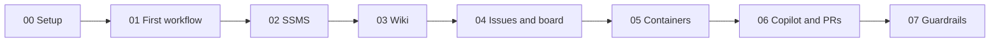

# GitHub, Automation, and a Little Bit of Chaos

The demo repo from my Day of Data Portland 2026 session. It shows how a SQL Server team can let GitHub do the busy work: testing, tracking requests, reviews, and docs.

Each demo is a numbered folder with one command. "DEMO 05" on a slide means the `05_Containers` folder.

## Try it in 2 minutes

You only need [Docker Desktop](https://www.docker.com/products/docker-desktop/) and [PowerShell 7](https://learn.microsoft.com/en-us/powershell/scripting/install/installing-powershell).

1. Fork this repo and clone your fork.
2. Start Docker Desktop.
3. From the repo folder, run:

       pwsh ./05_Containers/run.ps1

You'll see SQL Server start in a container, the DemoShop database deploy, and the tests pass.

## The steps

Run every command from the repo folder.

| Step | What you'll see | Run |
|---|---|---|
| [00 Setup](00_Prerequisites/) | Nothing on screen. This sets up your repo once. | `pwsh ./00_Prerequisites/run.ps1` |
| [01 First workflow](01_FirstWorkflow/) | A workflow starts, runs, and reports back | `pwsh ./01_FirstWorkflow/run.ps1` |
| [02 SSMS](02_SSMS/) | A change made in SSMS turns into a pull request | `pwsh ./02_SSMS/run.ps1` |
| [03 Wiki](03_DocsWikiMermaid/) | A wiki with a diagram on every page | `pwsh ./03_DocsWikiMermaid/run.ps1` |
| [04 Issues and board](04_TemplatesIssuesBoard/) | An issue form and a project board that fill in on their own | `pwsh ./04_TemplatesIssuesBoard/run.ps1` |
| [05 Containers](05_Containers/) | SQL Server starts, the tests run, then it's gone | `pwsh ./05_Containers/run.ps1` |
| [06 Copilot and PRs](06_CopilotAndPRs/) | A pull request that labels, reviews, and merges itself | `pwsh ./06_CopilotAndPRs/run.ps1` |
| [07 Guardrails](07_Guardrails/) | A checker that grades workflows, and a job that files its own bug | `pwsh ./07_Guardrails/run.ps1` |
| [99 Cleanup](99_Cleanup/) | Nothing on screen. This resets the repo for next time. | `pwsh ./99_Cleanup/run.ps1` |

Add `-Pause` to any command to stop and wait for Enter between actions.

## Run the whole talk on your fork

1. Install the tools listed in [00 Setup](00_Prerequisites/README.md).
2. Run `gh auth login`, then `gh auth refresh -s project`.
3. Run `pwsh ./00_Prerequisites/run.ps1`.
4. Run `pwsh ./03_DocsWikiMermaid/run.ps1` to publish the wiki.
5. Run `pwsh ./04_TemplatesIssuesBoard/run.ps1` to build the board, then do the two clicks it prints.
6. Run steps 01 through 07 in order.
7. Run `pwsh ./99_Cleanup/run.ps1` when you're done.

## See it on GitHub

- [Wiki](https://github.com/amyabelsql/DayOfData_Portland_2026/wiki)
- [Project board](https://github.com/users/amyabelsql/projects)
- [Actions](https://github.com/amyabelsql/DayOfData_Portland_2026/actions)

## If something goes wrong

- **Apple Silicon Mac.** In Docker Desktop, open Settings > General and turn on "Use Rosetta for x86_64/amd64 emulation on Apple Silicon".
- **SQL Server won't start.** The password needs at least 8 characters and three of these: uppercase, lowercase, numbers, symbols. Delete `.env` and run step 05 again to get a new one.
- **Port 1433 is busy.** Stop the other SQL Server on your machine. Or change `"1433:1433"` in `compose.yaml` to `"1434:1433"` and run `$env:SQL_SERVER = 'localhost,1434'` before step 05.
- **gh says the project scope is missing.** Run `gh auth refresh -s project`.

## Test it

This checks everything that runs on your machine. Add `-Rounds 5` to run it five times in a row.

    pwsh ./scripts/Test-Local.ps1

## What's in the repo

| Folder | What it holds |
|---|---|
| `00_` to `99_` | One folder per step, each with a README and a `run.ps1` |
| `database/` | The DemoShop database: tables, procs, sample data, rollbacks, and tests |
| `scripts/` | Helpers the steps share |
| `.github/` | Workflows, the issue form, the PR template, and the rules Copilot follows |

MIT licensed. Fork it and make it yours.
